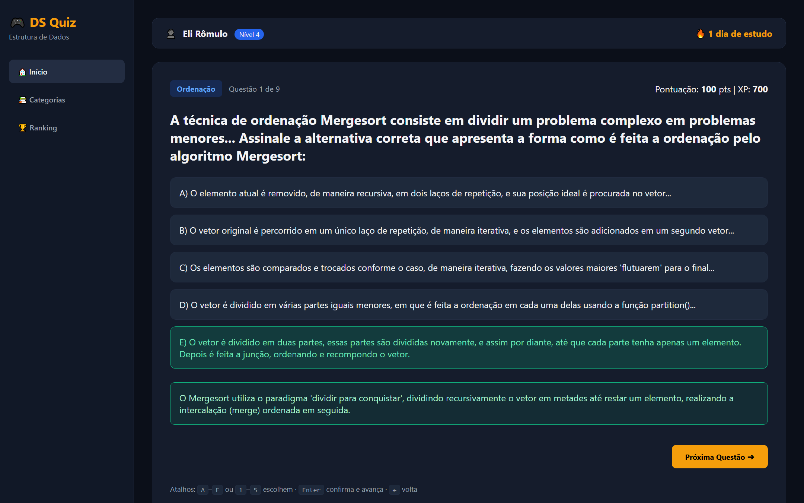
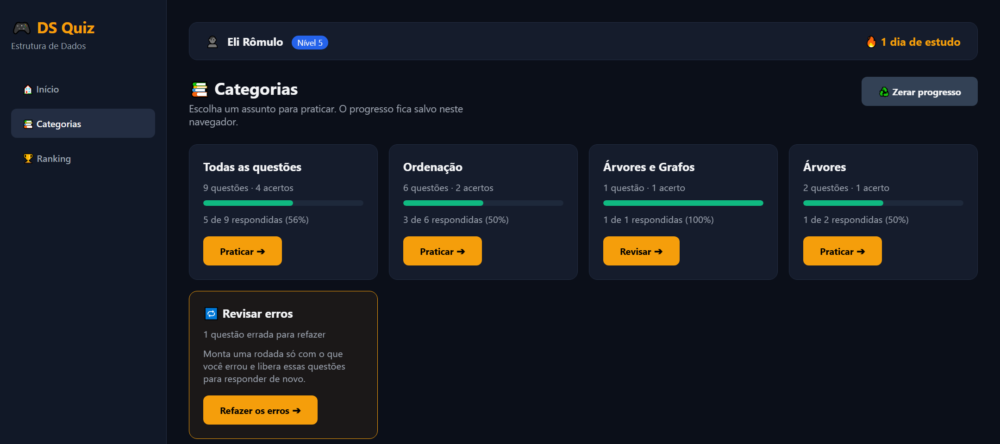

# DS Quiz — Estrutura de Dados

Quiz gamificado para estudar Estrutura de Dados: algoritmos de ordenação, árvores binárias e
grafos. Cada resposta é corrigida na hora, com a alternativa certa destacada e a explicação do
porquê — a ideia é que o erro vire revisão, não só nota.

Front-end puro: HTML, CSS e JavaScript sem dependências, sem build e sem back-end. Abrir o
`index.html` no navegador já roda.



## Como rodar

Não precisa instalar nada nem subir servidor:

```bash
git clone https://github.com/GitShiryu/ds-quiz-estrutura-de-dados.git
cd ds-quiz-estrutura-de-dados
start index.html     # Windows
# open index.html    # macOS
# xdg-open index.html # Linux
```

## O que tem

**Três telas**, na barra lateral:

- **Início** — o quiz. Alternativa certa em verde, errada em vermelho e a explicação logo abaixo
  (verde quando você acerta, vermelha quando erra). Dá para voltar, pular (custa 10 pts) e ver em
  que questão da rodada você está.
- **Categorias** — um card por assunto, com quantas questões tem, quantas você já respondeu, a
  barra de progresso e os acertos. O botão abre uma rodada só daquele assunto. Quando existe
  questão errada, aparece também um card **Revisar erros**, que monta uma rodada apenas com o que
  você errou e libera essas questões para responder de novo.
- **Ranking** — sua pontuação entra na tabela em tempo real, ordenada e destacada. Os outros
  jogadores são fictícios, e a própria tela diz isso: servem só para dar escala.



**Progresso e pontuação**

- Acerto vale 100 pts e 50 XP; pular custa 10 pts; errar não tira ponto.
- O nível é derivado do XP, não guardado à parte.
- A pontuação é **calculada a partir das respostas salvas**, nunca acumulada num contador. Por
  isso voltar numa questão, reconfirmar ou recarregar a página não inventa pontos: a questão já
  respondida reabre mostrando o resultado, travada.
- A sequência de dias ("🔥 N dias consecutivos") é contada de verdade pela data da última visita:
  soma se você voltou no dia seguinte, reinicia se faltou um dia.
- Tudo fica em `localStorage`, por navegador. Nada vai para servidor nenhum — não existe back-end.
  Todo acesso ao storage é protegido por `try/catch`: se o navegador bloquear (acontece em
  `file://`), o app roda normalmente, só sem lembrar entre sessões.

**Atalhos de teclado** (na aba Início): `A`–`E` ou `1`–`5` escolhem, `Enter` confirma e avança,
`←` volta.

**Acessibilidade**: navegação por teclado com foco visível, link "pular para o conteúdo",
`role="tab"`/`aria-selected` no menu, `aria-live` na explicação (leitores de tela anunciam a
correção), `role="progressbar"` nas barras das categorias e respeito a
`prefers-reduced-motion`. Layout responsivo até largura de celular.

## Testes

A suíte roda o app de verdade no Chrome headless — sem framework, sem `npm install`:

```bash
bash teste/rodar-testes.sh
```

São 57 checagens cobrindo pontuação, pular, não-duplicação ao voltar, resposta errada, tela final,
revisar erros, filtro por categoria, troca de abas, atalhos de teclado, ordenação do ranking e a
regra da sequência de dias (incluindo virada de mês, de ano e horário de verão). O script sai com
código 1 se qualquer checagem falhar, então serve em CI.

Se o Chrome não estiver num caminho padrão: `CHROME=/caminho/para/chrome bash teste/rodar-testes.sh`.

## Estrutura

```
index.html     telas (quiz, categorias, ranking)
style.css      estilos, incluindo o layout responsivo
script.js      banco de questões + toda a lógica
teste/         suíte automatizada e o runner
legado/        protótipo original, de arquivo único com Tailwind via CDN
docs/          imagens do README
PROGRESSO.md   diário do projeto
```

`legado/ds_quiz_estrutura_de_dados.html` é a primeira versão, num arquivo só, com 7 questões e
Tailwind pelo CDN. Está guardada como histórico e **não** acompanha mais o app — quem manda é a
versão da raiz.

## Banco de questões

As 9 questões ficam em `questionsDB`, no topo do `script.js`. Para acrescentar uma:

```js
{
    category: "Ordenação",          // categoria nova vira card sozinha
    question: "Enunciado...",       // \n vira quebra de linha na tela
    options: ["A...", "B...", "C...", "D...", "E..."],
    correct: 4,                     // índice da certa, começando em 0
    explanation: "Por que essa é a correta."
}
```

Nada mais precisa mudar: categorias, contagens, barras de progresso e tela final se ajustam
sozinhas.

## Licença

MIT — veja [LICENSE](LICENSE).

## Autor

Eli Rômulo de Araújo Martins — [portfólio](https://romulofullstack.duckdns.org) ·
eliromulo@gmail.com
